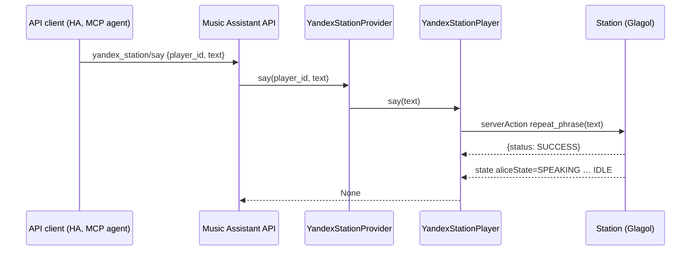

## Problem Statement

A Yandex Station can say any phrase in Alice's own voice and can handle a text request
as if the user had spoken it ("включи свет на кухне"). The provider already has both
Glagol calls, but nothing in Music Assistant can reach them. Automations, the Home
Assistant integration and LLM agents (for example through the FastMCP Server plugin)
can only send announcements, and those use a generic TTS voice instead of Alice's.

## Research: where this fits in Music Assistant

- **Text announcements are rendered audio.** `players/cmd/play_announcement` takes a
  `message` and an optional `tts_engine`. The controller renders the text through a TTS
  engine into an audio URL, and the player only receives that URL
  (`Player.play_announcement(announcement: PlayerMedia)`). The Station already supports
  `PLAY_ANNOUNCEMENT`, so any Music Assistant TTS engine (OpenAI TTS, Home Assistant TTS)
  already works on it. The text itself never reaches the player.
- **Alice cannot be a TTS engine.** Engines are exposed only by plugin providers that
  declare `ProviderFeature.TTS`, and `get_tts_message` must return `StreamDetails` for an
  audio file or URL. Alice speaks on the device and returns no audio. A marker URL that
  the Station would recognise would break the contract for group announcements and for
  every other player.
- **Provider API commands are the supported extension point.** A provider can register
  its own commands with `mass.register_api_command` and must unregister them on unload.
  The `party`, `ambient_sounds` and `sonic_similarity` providers do this upstream. The
  method exists in Music Assistant 2.10 (single `Scope` argument), which is this
  provider's minimum version. The provider is not multi-instance, so fixed command names
  cannot collide.
- **LLM integration belongs to the AI engines.** Music Assistant has
  `ProviderFeature.AI_QUERY` engines (the `openai_compatible` plugin, used by
  `music_quiz` and `ai_radio`), resolved with `resolve_ai_engine`. A voice assistant
  should consume those instead of bundling its own LLM client. That is out of scope here
  and fits the Yandex Alice skill provider better; these commands give such a consumer a
  way to answer in Alice's voice.

## Solution Summary

The provider registers its API commands when it is loaded and removes them on unload.
Both require the `players.control` scope and apply the same per-user player
restriction (`player_filter`) as the core player commands:

- `yandex_station/say` with `player_id` and `text`: the Station says the text in
  Alice's voice (the `repeat_phrase` scenario).
- `yandex_station/command` with `player_id` and `text`: the Station handles the text as
  a spoken request to Alice (Glagol `sendText`). Alice can then act on everything linked
  to the Yandex account (smart home devices, scenarios), which is far more than player
  control, so this command is only registered when the provider-level option
  `alice_text_commands` is turned on. It is off by default.

Each player gains matching `say()` and `send_command()` methods that raise
`PlayerCommandFailed` when the Station reports a failure. Unknown or non-Station player
ids raise `PlayerUnavailableError`; a user whose `player_filter` excludes the Station gets
`InsufficientPermissions`; empty text raises `InvalidDataError`.

## Acceptance Criteria

1. After the provider is loaded, `yandex_station/say` is registered with the
   `players.control` scope. `yandex_station/command` is registered as well only when the
   `alice_text_commands` provider option is on (default off).
2. Unloading the provider unregisters both commands, so reloading it does not fail with
   "already registered".
3. `yandex_station/say` sends the `repeat_phrase` server action carrying the text to the
   addressed Station.
4. `yandex_station/command` sends a Glagol `sendText` command carrying the text to the
   addressed Station.
5. A Glagol transport error or a non-`SUCCESS` status raises `PlayerCommandFailed`.
6. A `player_id` that is not a registered Yandex Station raises
   `PlayerUnavailableError`; blank text raises `InvalidDataError`, and nothing is sent.
7. A user whose `player_filter` does not include the Station gets
   `InsufficientPermissions`, and nothing is sent.

## Test Plan

- `test_loaded_in_mass_registers_only_say_by_default`,
  `test_loaded_in_mass_registers_alice_commands`, `test_unload_unregisters_alice_commands`:
  opt-in, names, scope and unregister handles.
- `test_api_say_rejects_player_outside_user_filter`,
  `test_api_say_allows_player_in_user_filter`: per-user player restriction.
- `test_say_sends_repeat_phrase`, `test_send_command_sends_text`: real player methods
  produce the expected Glagol payloads.
- `test_say_raises_on_glagol_error`, `test_send_command_raises_on_non_success_status`.
- `test_api_say_rejects_unknown_player`, `test_api_say_rejects_blank_text`,
  `test_api_command_routes_to_player`.
- Manual: call `yandex_station/say` from the API explorer on an idle Station and during
  Music Assistant playback with voice control on and off; call `yandex_station/command`
  with "сколько времени".

## Sequence Diagram

## Notes

- The per-user check reads `player_filter` directly. Music Assistant `dev` wraps the same
  rule in `has_player_access`, which does not exist in 2.10, this provider's minimum.

- While Alice speaks, the Station reports `aliceState=SPEAKING`. With voice control on,
  a running Music Assistant stream is paused and resumed afterwards, as for a spoken
  request. With an intercept session active, the target player is paused while Alice
  speaks. Both are existing behaviours and need a manual check on a real Station.
